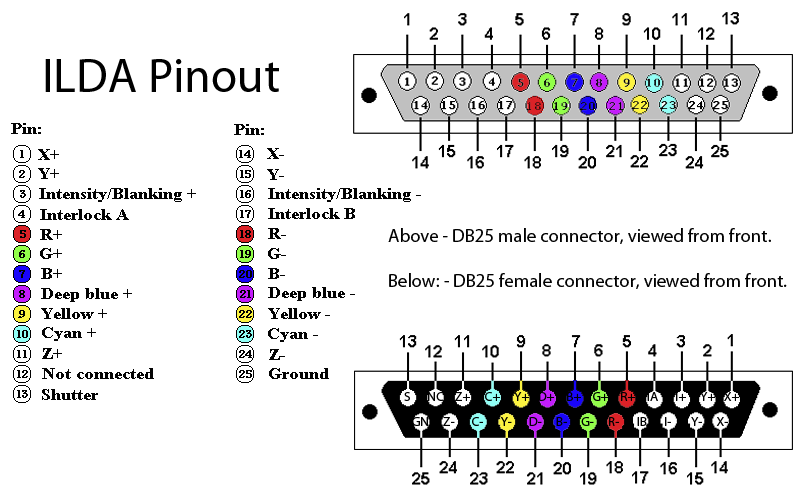

# lasertargets

Augmented reality laser game platform.

> 📖 **Developer & Stability Guidelines**: See [INSTRUCTIONS.md](INSTRUCTIONS.md) for USB DAC hardware rules, Bevy ECS conventions, and network state invariants.  
> 🔌 **Hardware Wiring & Pinouts**: See [docs/ILDA_PINOUT.md](docs/ILDA_PINOUT.md) for DB25 to RJ45 (Cat5/Cat6) ILDA adapter pinout mapping.  
> 🎯 **Scene-Filling Strategies Plan**: See [docs/FILL_STRATEGIES_PLAN.md](docs/FILL_STRATEGIES_PLAN.md) for hardware playback of raster, spiral, lissajous, and hilbert fill strategies.  
> 🧩 **Transformer Pipeline Architecture**: See [docs/TRANSFORMER_PIPELINE.md](docs/TRANSFORMER_PIPELINE.md) for Bevy ECS plugin and component architecture.  
> 📷 **Camera Stream & Vision Tracking Plan**: See [docs/CAMERA_STREAM_PLAN.md](docs/CAMERA_STREAM_PLAN.md) for Sony IMX219 (Pi Cam v2) capture pipeline and laser hit detection.  
> 🔊 **Galvo Acoustic Audio & Synthesis Plan**: See [docs/GALVO_AUDIO_PLAN.md](docs/GALVO_AUDIO_PLAN.md) for galvo carrier injection, acoustic sound effects, harmonic shapes, and laser theremin.



## Local Development Build

Server:

cargo build --package server --features bevy/dynamic_linking
cargo run --package server --features bevy/dynamic_linking

Terminal:

cargo build --package terminal --features bevy/dynamic_linking
cargo run --package terminal --features bevy/dynamic_linking

## Raspberry Pi 4

> **Full guide**: [docs/raspberry-pi.md](docs/raspberry-pi.md) — SSH setup, cross-compilation,
> deploy, live output capture, and troubleshooting.

### Hardware & Connected Peripherals Profile

| Component | Hardware Specification | Interface & Driver | Role in Platform |
| :--- | :--- | :--- | :--- |
| **Compute Host** | Raspberry Pi 4 Model B (ARM Cortex-A72 @ 1.5 GHz, 4GB RAM) | `aarch64-unknown-linux-gnu` | Runs Bevy laser server daemon & network dispatch |
| **Laser Projector DAC** | Helios Laser DAC (`1105:f001`) | USB 2.0 / `libHeliosLaserDAC.so` | Streams differential X/Y galvo signals & RGB ILDA |
| **Vision Camera** | Sony IMX219 (Raspberry Pi Camera Module v2) | MIPI-CSI2 ribbon / Unicam (`libcamera`) | High-speed laser hit tracking (640x480 @ 200 FPS) & calibration |
| **Hardware ISP** | VideoCore VI Image Signal Processor (`bcm2835-isp`) | `/dev/video13–16` | On-chip hardware demosaicing & color conversion |
| **Hardware Codec** | VideoCore VI Codec (`bcm2835-codec`) | `/dev/video11` (H.264 / MJPEG) | Zero-CPU video compression for remote terminal stream |
| **Secondary Camera** | Realtek USB Webcam (`0bda:5830`) | USB 2.0 / UVC (`/dev/video1`) | Auxiliary feed (`/dev/video1`) |

### Quick Start

**1. Build** (cross-compile for aarch64 inside Docker, no Rust toolchain needed on host):

*Local build (Linux/macOS/Git Bash):*
```bash
./scripts/build-pi.sh
```

*Remote build (Windows PowerShell):*
```powershell
.\scripts\docker-build-rpi4-remote.ps1 -RemoteHost joel@192.168.1.110
```

Outputs `dist/pi/server` and `dist/pi/libHeliosLaserDAC.so`.

**2. Deploy** (copy binary to Pi over SSH and install systemd service):

```bash
./scripts/deploy-pi.sh lasertargets@<IP>
```

**3. Follow live output** in your terminal:

*If logging to systemd:*
```bash
ssh lasertargets@<IP> 'sudo journalctl -u lasertargets-server -f'
```

*If logging to USB stick:*
```bash
ssh lasertargets@<IP> 'tail -f /mnt/usb-logs/server.log'
```

## Game Console Controls

When a game console controller (Xbox / PlayStation / DirectInput / XInput) is connected to the server, the following button mappings are available:

| Button | Action | Description |
| :--- | :--- | :--- |
| **A (South)** | **Cycle Target Selection** | Cycles through reticle modes in Hunter game (GunShot $\rightarrow$ Red Circle $\rightarrow$ Yellow Balloon $\rightarrow$ Cyan Circle $\rightarrow$ Magenta Balloon) |
| **B (East) / RT** | **Spawn Target / Shoot** | Spawns selected target shape at cursor position (if target selected) or shoots at target (in GunShot mode) |
| **X (West)** | **Game Menu Switcher** | Cycles through Hunter $\rightarrow$ Snake $\rightarrow$ Main Menu |
| **Y (North)** | **Calibration Toggle** | Toggles Calibration overlay On / Off |
| **LB / RB** | **Target Size / Distance** | Increases / decreases target radius in Hunter game, or adjusts scene distance (in Calibration mode) |
| **Start** | **Laser Power Toggle** | Toggles laser projector power output On / Off |
| **Select** | **Status Report** | Logs diagnostic status report of server mode, peripherals, and network connections |
| **DPad Up / Down** | **Adjust Height / Direction** | Adjusts scene height (in Calibration mode) or controls Snake direction |
| **DPad Left / Right** | **Adjust Width / Direction** | Adjusts scene width (in Calibration mode) or controls Snake direction |
